# DSO202 Practical 4 – GitOps with Argo CD

## 1. Aim

The aim of this practical was to learn how to deliver Kubernetes resources using **GitOps**. I used **Argo CD** to make a GitHub repository the single source of truth for my cluster, then tested three core GitOps behaviours:

1. Changing the cluster only through Git commits.
2. **Self-healing** when someone changes the cluster manually (configuration drift).
3. **Automatic pruning** when a resource is deleted from Git.

## 2. Background

In traditional **push-based** CI/CD, a pipeline holds cluster admin credentials and runs `kubectl apply`. This has three problems:
- It is a security risk, because the pipeline holds the cluster credentials.
- There is no visibility after deployment.
- The cluster slowly drifts away from what is in Git.

**GitOps** uses a **pull-based** model instead. An agent (Argo CD) runs *inside* the cluster, continuously pulls the desired state from Git, and reconciles the cluster to match it. It follows the four OpenGitOps principles:

| Principle | How I applied it in this practical |
|---|---|
| Declarative | All resources are YAML manifests in `manifests/` |
| Versioned & Immutable | Every change is a Git commit with an author, timestamp and hash |
| Pulled Automatically | Argo CD polls GitHub and pulls changes into the cluster |
| Continuously Reconciled | `selfHeal: true` reverts any manual drift back to Git |

Argo CD itself is a Kubernetes controller. It adds new CRDs, such as `kind: Application`, and runs a reconciliation loop that compares the **desired state** (Git) with the **live state** (cluster).

## 3. Tools Used

| Tool | Purpose |
|---|---|
| Docker | Runs the Kind node containers |
| Kind | Local multi-node Kubernetes cluster (`dso202`) |
| kubectl | Read-only debugging and inspection |
| Argo CD v3.6.1 | GitOps controller |
| Git & GitHub | Single source of truth for the manifests |

## 4. Repository Structure

```
DSO202_Practical4/
├── kind-config.yaml      # 3-node Kind cluster (1 control plane + 2 workers)
├── argocd-app.yaml       # Argo CD Application definition
├── manifests/            # Desired state watched by Argo CD
│   ├── deployment.yaml   # webapp-deploy (nginxdemos/hello:plain-text)
│   └── service.yaml      # webapp-svc (ClusterIP, port 80)
└── screenshots/          # Evidence for this report
```

---

## 5. Part A – Environment Setup

### 5.1 Creating the 3-node Kind cluster

I created a Kind cluster named `dso202` with one control-plane node and two worker nodes, using `kind-config.yaml`:

```yaml
kind: Cluster
apiVersion: kind.x-k8s.io/v1alpha4
nodes:
  - role: control-plane
  - role: worker
  - role: worker
```

```bash
kind create cluster --name dso202 --config kind-config.yaml
kubectl get nodes
```

All three nodes are in the `Ready` state:

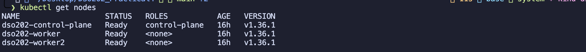

### 5.2 Installing Argo CD

I installed Argo CD into its own dedicated `argocd` namespace. I used `--server-side` because the Argo CD CRDs are too large for the normal client-side apply annotation.

```bash
kubectl create namespace argocd
kubectl apply -n argocd --server-side --force-conflicts \
  -f https://raw.githubusercontent.com/argoproj/argo-cd/stable/manifests/install.yaml
kubectl get pods -n argocd
```

All Argo CD components are running. These include the API server, repo server, application controller, redis, dex and the notification controller:

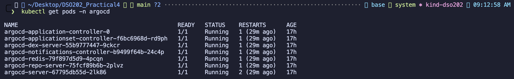

### 5.3 Accessing the Argo CD UI

The `argocd-server` Service is a ClusterIP, so I used port-forwarding to reach it. I got the initial admin password from the `argocd-initial-admin-secret` Secret:

```bash
kubectl -n argocd get secret argocd-initial-admin-secret -o jsonpath="{.data.password}" | base64 -d
kubectl port-forward svc/argocd-server -n argocd 8080:443
```

Then I opened `https://localhost:8080` and logged in as `admin`:

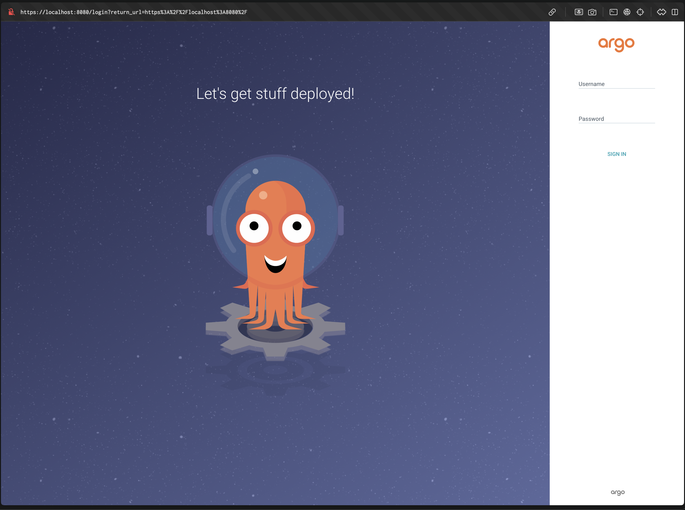

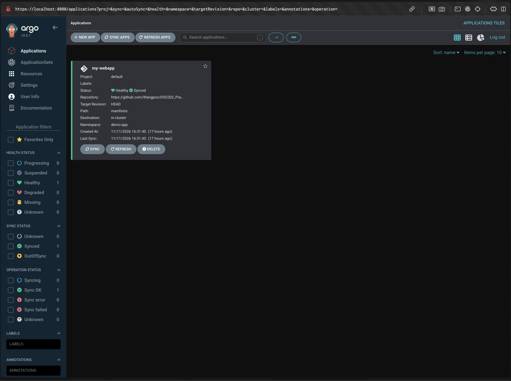

### 5.4 Preparing the GitHub repository (desired state)

I created a `manifests/` folder containing `deployment.yaml` (2 replicas of `nginxdemos/hello:plain-text`) and `service.yaml` (a ClusterIP Service on port 80), then committed and pushed them to GitHub:

```bash
git add .
git commit -m "Initial deployment with 2 replicas"
git push origin main
```

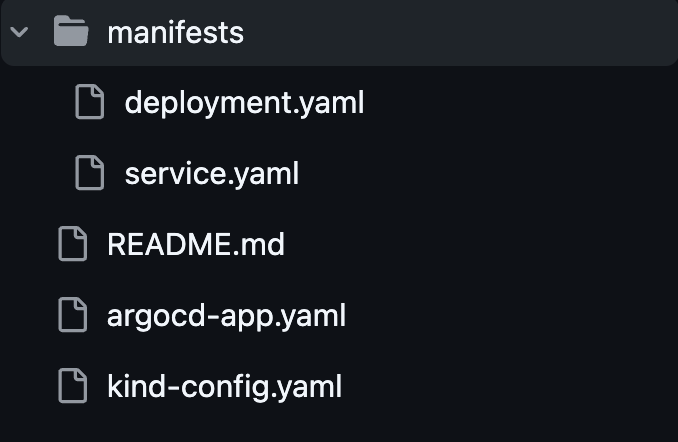

### 5.5 Registering the application declaratively

Instead of clicking **+ NEW APP** in the UI, I defined the Argo CD `Application` itself as YAML, which is the GitOps way:

```yaml
apiVersion: argoproj.io/v1alpha1
kind: Application
metadata:
  name: my-webapp
  namespace: argocd
spec:
  project: default
  source:
    repoURL: https://github.com/Wangpos/DSO202_Practical4.git
    targetRevision: HEAD
    path: manifests
  destination:
    server: https://kubernetes.default.svc
    namespace: demo-app
  syncPolicy:
    automated:
      prune: true
      selfHeal: true
    syncOptions:
      - CreateNamespace=true
```

```bash
kubectl apply -f argocd-app.yaml
```

The `my-webapp` application appeared with status **Healthy** and **Synced**:

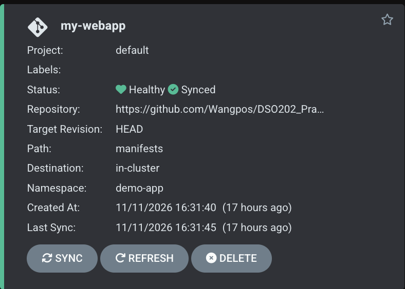

The resource tree shows the full hierarchy that Argo CD created from Git: **Application → Deployment → ReplicaSet → 2 Pods**, plus the **Service**:

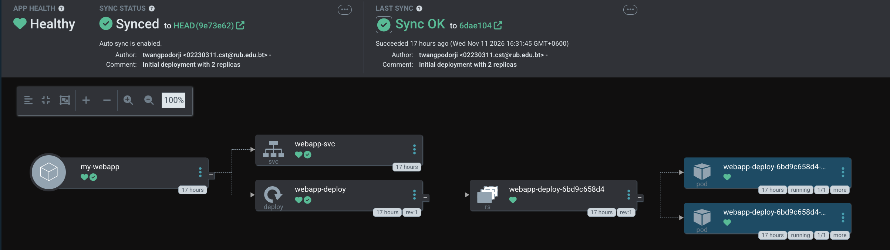

The two pods are spread across both worker nodes (`dso202-worker` and `dso202-worker2`):

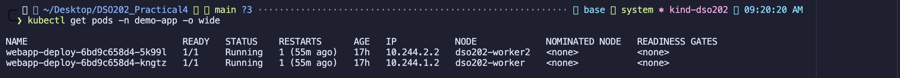

---

## 6. Part B – Experiment 1: Git as the Single Source of Truth

**Goal:** scale the application from 2 to 4 replicas without touching `kubectl`.

I changed `replicas: 2` to `replicas: 4` in `manifests/deployment.yaml` and pushed the change:

```bash
sed -i '' 's/replicas: 2/replicas: 4/' manifests/deployment.yaml
git add manifests/deployment.yaml
git commit -m "Scale webapp to 4 replicas"
git push origin main
```

The GitHub diff shows the single-line change:

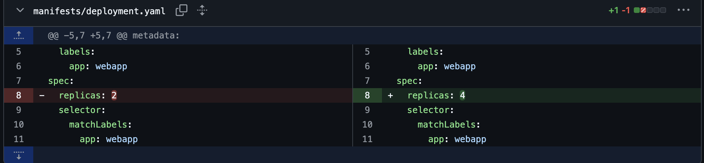

After I clicked **Refresh**, Argo CD detected the new commit (`b4a0619`) and synced automatically. The tree now shows **4 pods**. Two are older ("18 hours") and two are new ("44 minutes"), which shows the new pods were created because of the Git commit.

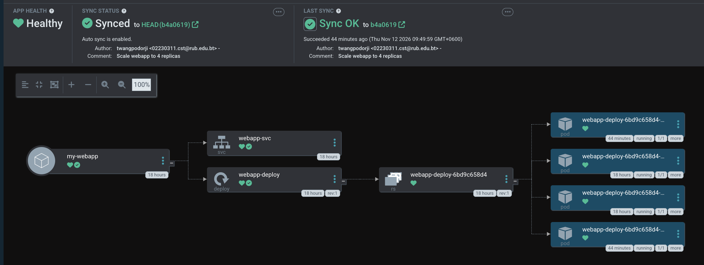

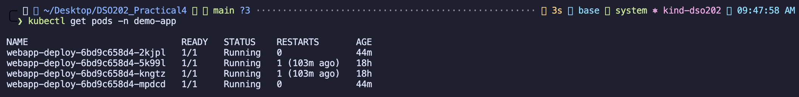

**Observation:** I never ran `kubectl apply` or `kubectl scale`. Committing to Git was enough to change the cluster.

---

## 7. Part C – Experiment 2: Configuration Drift & Self-Healing

**Goal:** simulate a "rogue admin" who bypasses Git and changes the cluster manually.

```bash
kubectl scale deployment webapp-deploy -n demo-app --replicas=1
kubectl get pods -n demo-app -w
```

Right after the manual scale-down, there was only one old pod left, plus **three brand-new pods only 4 seconds old**. Argo CD had already put the deployment back to 4 replicas:

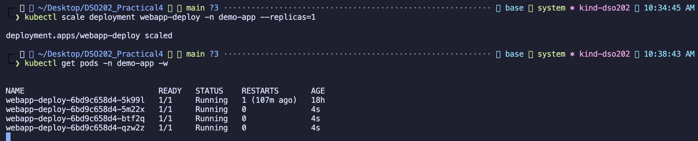

The Deployment was back to `4/4` ready:

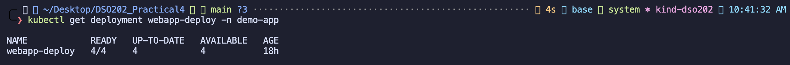

The Kubernetes and Argo CD events show exactly what happened:
- **Deployment events:** `Scaled down ... from 4 to 1` (my manual change), then **2 seconds later** `Scaled up ... from 1 to 4` (Argo CD).
- **Application events:** `Synced -> OutOfSync`, then `Initiated automated sync`, then `OutOfSync -> Synced`, then `Healthy`.

```bash
kubectl get events -n argocd --field-selector involvedObject.name=my-webapp --sort-by=.lastTimestamp | tail -6
kubectl get events -n demo-app --field-selector involvedObject.kind=Deployment --sort-by=.lastTimestamp
```

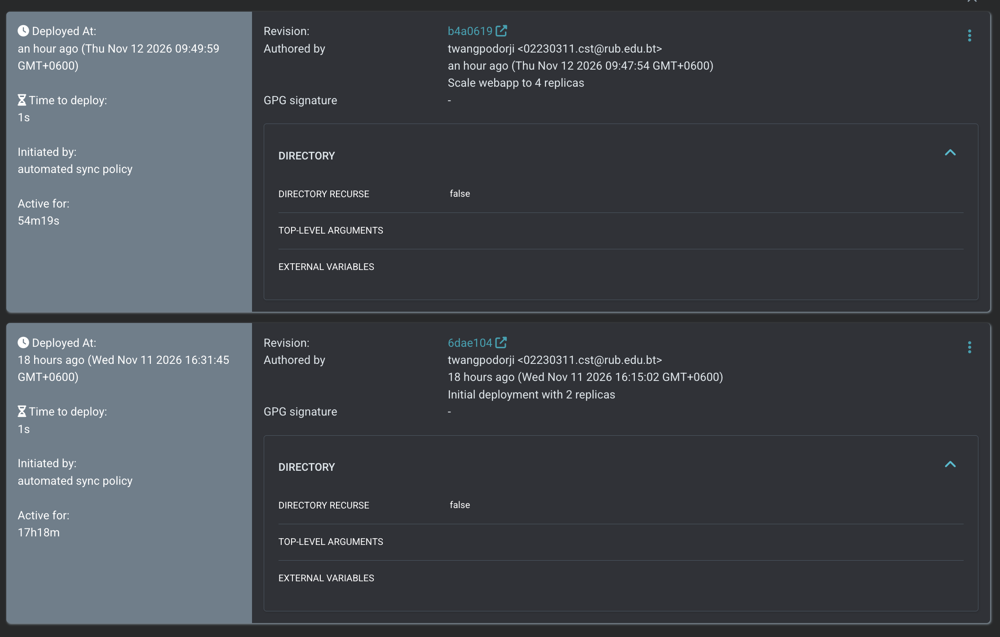

**Observation:** with `selfHeal: true`, configuration drift is corrected within seconds. Git stays the only source of truth, and manual `kubectl` changes don't last.

---

## 8. Part D – Experiment 3: Automatic Pruning

**Goal:** check that deleting a manifest from Git also deletes the resource from the cluster.

```bash
git rm manifests/service.yaml
git commit -m "Remove webapp service"
git push origin main
```

The commit shows all 12 lines of `service.yaml` deleted:

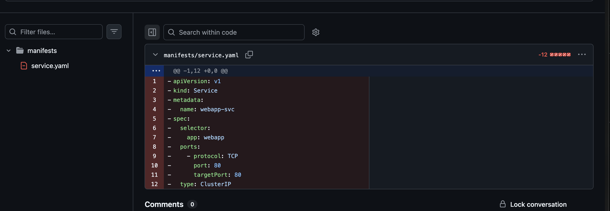

After a refresh, Argo CD synced to commit `7796148`, and the `webapp-svc` box disappeared from the tree. Compare this with the earlier tree in section 5.5:

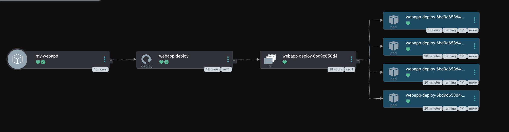

The Service was also removed from the cluster:

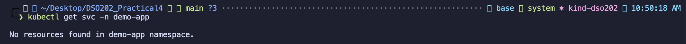

### 8.1 Rolling back with `git revert`

To bring the Service back, I reverted the last commit instead of recreating it by hand:

```bash
git revert HEAD --no-edit
git push origin main
```

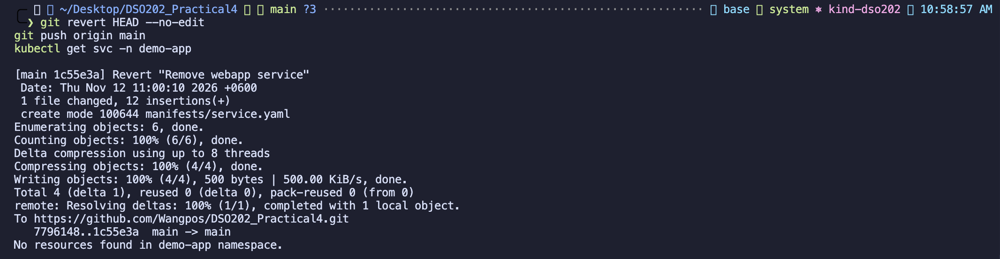

Argo CD synced to the revert commit `1c55e3a` and recreated `webapp-svc` ("a few seconds" old), while the 4 pods kept running:

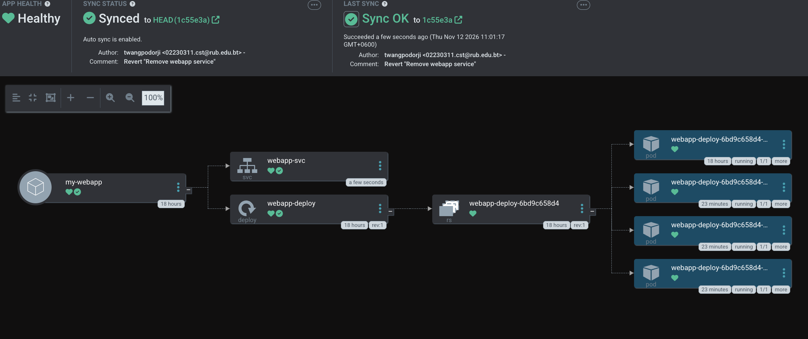

**Observation:** with `prune: true`, removing a file from Git removes the resource from Kubernetes. A rollback is just a `git revert`, and that rollback is recorded in Git history as well.

---

## 9. Git History – GitOps Audit Trail

Every change to the cluster in this practical is a commit, so `git log` is a complete audit trail of who changed what and when:

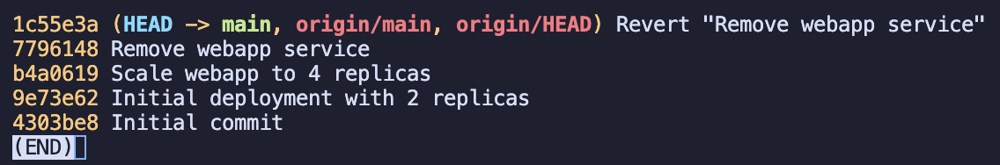

| Commit | Change in the cluster |
|---|---|
| `9e73e62` | Initial deployment: 2 replicas + Service |
| `b4a0619` | Scaled to 4 replicas |
| `7796148` | Service pruned |
| `1c55e3a` | Service restored (rollback) |

---

## 10. Clean Up

After collecting all the evidence, I deleted the Kind cluster. `kind-dso202` no longer appears in the kubectl contexts:

```bash
kind delete cluster --name dso202
```

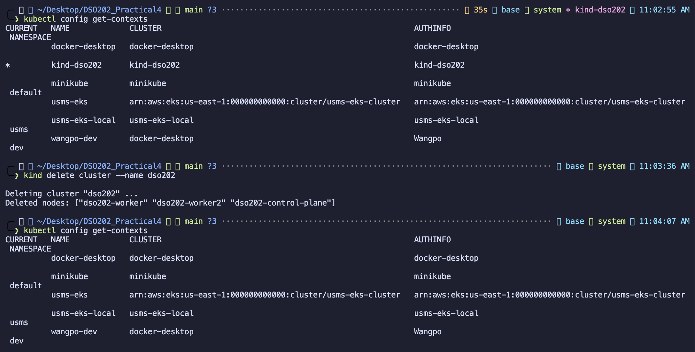

Because the whole desired state is in Git, I can rebuild the same application at any time by recreating the cluster, installing Argo CD and applying `argocd-app.yaml`.

---

## 11. Challenges Faced

| Challenge | Solution |
|---|---|
| A normal `kubectl apply` of the Argo CD install manifest can fail on large CRDs ("annotations too long") | Used `kubectl apply --server-side --force-conflicts` |
| Argo CD and nginx images took a long time to pull on a slow connection, so pods stayed in `ContainerCreating` | Waited and checked `kubectl describe pod`, which showed the image was still pulling |
| The cluster stopped when Docker stopped (Mac sleep), and the port-forward broke | Restarted the node containers with `docker start ...` and ran the port-forward again; Argo CD and the app came back unchanged |
| Argo CD did not react to a push straight away (it polls every 3 minutes) | Clicked **Refresh** in the UI to force an immediate check |
| The lab guide used two different repository names (`dso202-gitops-demo` / `k8s-gitops-demo`) | Used my own repository and made sure `repoURL` matched it exactly |

## 12. Conclusion

In this practical I built a working GitOps pipeline with Argo CD on a 3-node Kind cluster. I confirmed that:

- **Git is the single source of truth.** Scaling the application only needed a commit, not `kubectl`.
- **Self-heal** detects configuration drift and reverts manual changes within seconds.
- **Prune** keeps the cluster clean by removing resources that were deleted from Git.
- **Rollback** is as simple as `git revert`, and every change is auditable through `git log`.

Compared with push-based CI/CD, the pull-based GitOps model is more secure, because no external system holds cluster credentials. It is also more reliable, because the cluster continuously reconciles itself to Git, and easier to audit, because every change is a reviewed and versioned commit.
